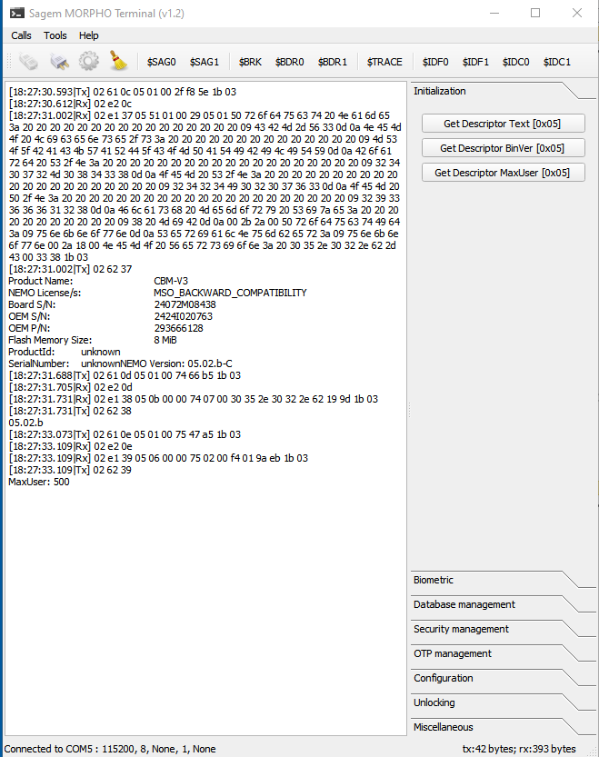
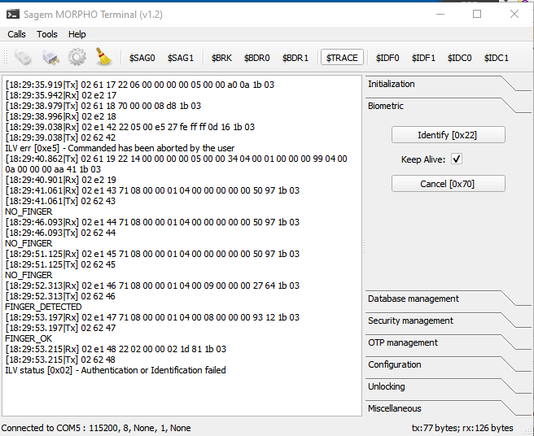
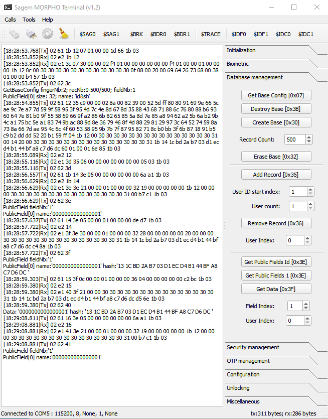

# Přehled projektu

`sagem-morpho-terminal` je desktopová aplikace v C++ a Qt pro komunikaci se zařízeními Sagem Morpho přes sériový port. Spojuje jednoduchý terminál s ovládacími prvky pro běžné příkazy čtečky a s implementací binárního protokolu Morpho.

Aplikace používá Qt Widgets a Qt Serial Port. Nastavení portu zahrnuje rychlost, počet datových bitů, paritu, stop bity a řízení toku; dostupné porty lze vybrat přímo v dialogu.

# Vlastní sériové příkazy aplikace

Po navázání spojení terminál posílá a zobrazuje data ze sériové linky. Tlačítka `SAG0`, `SAG1`, `BDR0`, `BDR1`, `TRACE`, `IDF` a `IDC` odesílají vlastní textové příkazy aplikace do sériového promptu. Nejde o příkazy protokolu Sagem Morpho.

Odděleně aplikace implementuje binární operace Morpho. Jednotlivé moduly v `Morpho/` sestavují požadavky a dekódují odpovědi pro identifikaci, správu databáze, konfiguraci UART a další funkce.

# Rámování a kontrola dat

Komunikační vrstva v `morpho_protocol.c` vytváří rámce od značky začátku zprávy (SOP) po její konec (EOP). Data jsou přenášena v paketech ILV (identifikátor, délka a hodnota), kontrolována pomocí CRC a escapována, pokud obsahují řídicí bajty `DLE`, `XON` nebo `XOFF`.

Přijímací část kontroluje rámování i CRC, skládá vícečástové odpovědi a předává jejich hodnoty příslušným dekodérům. Uživatelské rozhraní následně zobrazuje chybové stavy protokolu a výsledky jednotlivých operací.

# Sestavení

Projekt je definovaný souborem `SagemMorphoUI.pro` a vyžaduje Qt moduly **Widgets** a **Serial Port**. Otevřete projekt v Qt Creator, vyberte odpovídající Qt kit a sestavte aplikaci. Pro komunikaci se zařízením nastavte v dialogu portu parametry odpovídající konkrétnímu terminálu.

# Další informace

Zdrojové kódy, dokumentace protokolu i další snímky obrazovky jsou v [repozitáři na GitHubu](https://github.com/CodElecCz/sagem-morpho-terminal).
