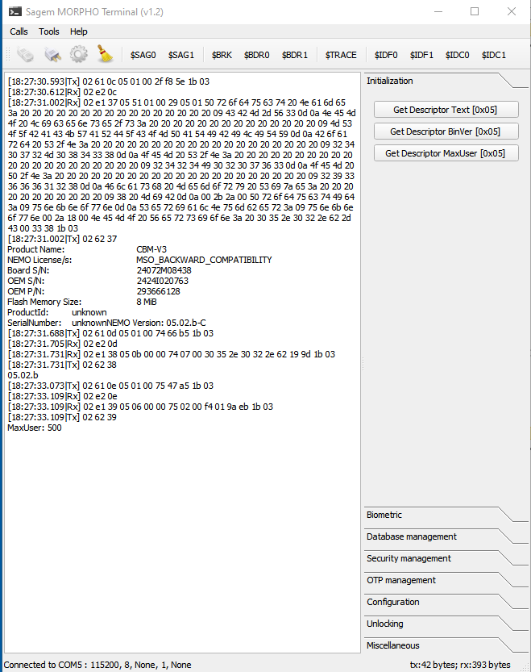
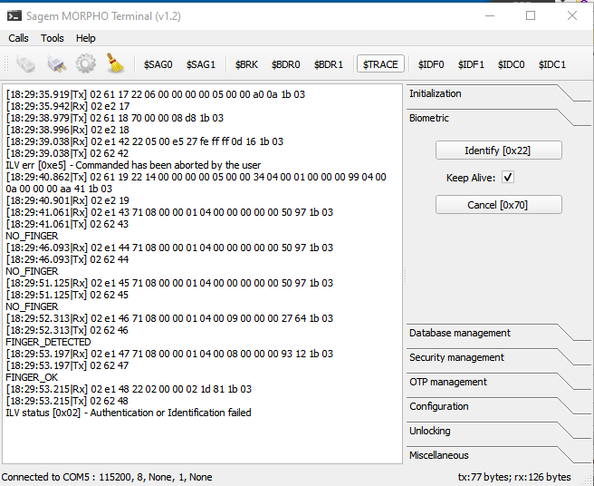
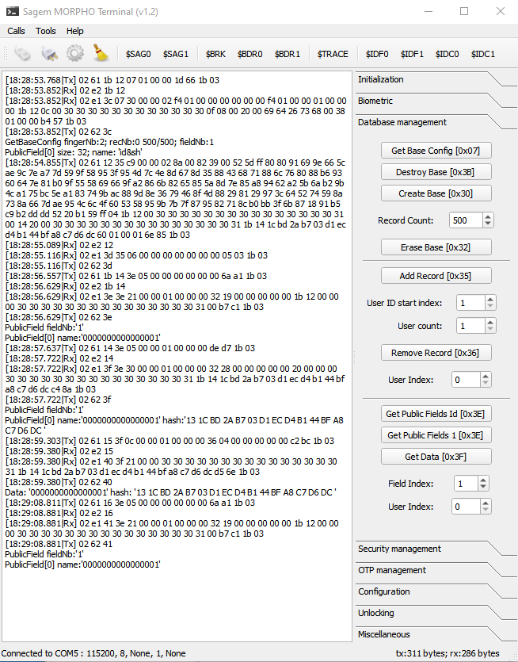

# Project overview

`sagem-morpho-terminal` is a C++ and Qt desktop application for communicating with Sagem Morpho devices over a serial port. It combines a simple terminal with controls for common reader commands and an implementation of the Morpho binary protocol.

The application uses Qt Widgets and Qt Serial Port. Port settings include baud rate, data bits, parity, stop bits, and flow control; available ports can be selected in the settings dialog.

# Application-specific serial commands

Once connected, the terminal sends and displays data from the serial link. The `SAG0`, `SAG1`, `BDR0`, `BDR1`, `TRACE`, `IDF`, and `IDC` buttons send application-specific text commands to the serial prompt. These are not commands in the Sagem Morpho protocol.

Separately, the application implements Morpho binary operations. Modules in `Morpho/` build requests and decode responses for identification, database management, UART configuration, and other functions.

# Framing and data validation

The communication layer in `morpho_protocol.c` builds frames from the start-of-packet marker (SOP) through the end-of-packet marker (EOP). Data is carried in ILV (identifier, length, value) packets, checked with a CRC, and escaped when it contains the control bytes `DLE`, `XON`, or `XOFF`.

The receive path validates framing and CRC, assembles multi-part responses, and passes their values to the relevant decoders. The user interface then displays protocol errors and operation results.

# Build

The project is defined by `SagemMorphoUI.pro` and requires the Qt **Widgets** and **Serial Port** modules. Open the project in Qt Creator, select a compatible Qt kit, and build the application. To communicate with a device, configure the serial port using settings appropriate for that specific terminal.

# More information

Source code, protocol documentation, and additional screenshots are available in the [GitHub repository](https://github.com/CodElecCz/sagem-morpho-terminal).
